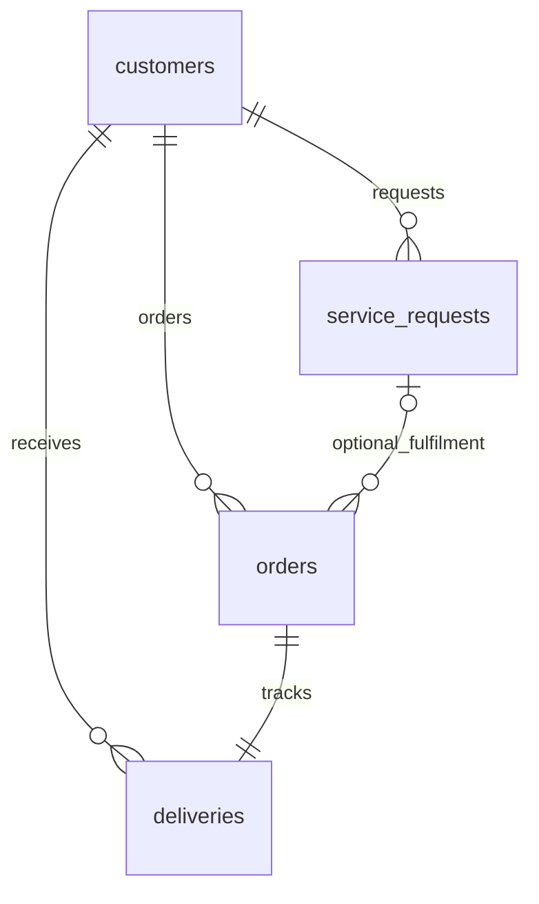

# Customer requests, equipment orders and delivery tracking

The managed Deepgram backend now uses the existing MongoDB `customers` collection
plus three linked collections. Run `python main.py --backend deepgram-agent` or
`start-agent.bat` with `MONGODB_URI` configured. Startup creates absent collections
and indexes without replacing existing data or validation rules. `--no-database`
keeps the backend public-RAG-only.

## Data model

All three store `customer_id`, `data_type: SYNTHETIC`, `schema_version: 1`,
`created_at`, `updated_at`, `call_id` and an idempotency key. Timestamps are UTC.
Customer names, phone numbers and smartcard IDs are not duplicated into them.
Each equipment order currently has one delivery containing all its line items.
Complaints may additionally reference an owned order and/or its delivery.

| Collection | Key and links | Main fields |
| --- | --- | --- |
| `service_requests` | `request_id`; optional `order_id`, `delivery_id` | `request_type`, `category`, `description`, `priority`, `status`, `location_address`, `preferred_window`, `scheduled_at` |
| `orders` | `order_id`; `delivery_id`; optional `service_request_id` | `items`, `status`, `total_price_inr`, `currency`, `delivery_address`, `notes` |
| `deliveries` | `delivery_id`; `order_id`; optional `service_request_id`; `item_ids` | `status`, `current_location`, `current_holder`, `courier`, `estimated_arrival_at`, `delivery_charge_inr`, `delivery_address`, `tracking_events` |

Order items have a generated order-line `item_id`, supported product code/name,
quantity, optional cable length and `unit_price_inr`. These item IDs are references,
not hardware serial numbers or activated smartcard numbers. Tracking events can
record time, status, location, holder and a note. Reads expose at most five records
and the ten most recent tracking events per delivery.

Unique indexes protect each record ID, per-collection idempotency keys and the
one-delivery-per-order relationship. Customer/date and customer/status indexes
support scoped queries. A partial unique index protects normalized customer phone
numbers while retaining imported records that lack that field. MongoDB enforces
basic collection validation; strict tool schemas and transaction-time checks enforce
application links. MongoDB does not provide automatic foreign-key constraints.

Existing `support_tickets`/DOCX records used by the original pipeline remain separate
and unchanged. The new managed-agent forms are MongoDB records; they do not silently
migrate old tickets or promise a DOCX export.

## Supported requests

Draft tools return `state: awaiting_confirmation` and `submission_attempted: false`.
This means preparation succeeded, not that MongoDB rejected a submission. A real
caller confirmation after the review question finishes playing triggers the local
transaction; ordinary confirmations can include polite fillers and repeated yes/okay.
Corrections and conditional replies require review again. Repeating an identical
draft preserves its confirmation readiness; changing the draft requires fresh consent.
After submission, late draft retries in the same caller turn return the receipt.
Transaction errors are logged separately from failures to send the result back to
the voice provider. A notification failure does not undo or duplicate a saved request.

Complaints cover missing recharge/payment credit, no TV signal, picture quality,
technician misconduct, poor support, pricing concerns, billing disputes and other
service issues. A complaint records the caller's report, not a verified finding.

Service requests cover a technician/service visit, new connection, relocation and
connection cancellation. Visits use the matched customer's saved address by
default; the caller does not need to dictate it. A supplied preferred window
is recorded as a preference. An actual appointment remains `scheduled_at: null`
until an operator confirms it. Cancellation is a request for review: existing
subscriptions, payments and customer account status are not changed.

Equipment requests support dishes, set-top/cable boxes, coaxial cable, duplicate
smartcards, remotes, connectors and power adapters. Quantities are bounded; cable
requests need a length in metres. Delivery uses the customer's saved address unless
the caller explicitly asks for a different destination. The selected address is
snapshotted into the draft/order/delivery and tagged with its source; an override
does not edit the customer's profile. If the saved address changes before commit,
a fresh draft/confirmation is required.
Supported request types are not an inventory or availability guarantee.

Address resolution prefers purpose-specific `service_address` or `delivery_address`,
then `home_address`/`address`, and supports a full string or structured house/street
fields. City/state alone is never treated as a house address. Complaints can still
be recorded if no address exists. New callers need to add an address once; a
relocation always needs its new destination rather than silently using the old home.

`python scripts/seed_customer_addresses.py` explicitly backfills missing **synthetic**
fixture addresses and ensures the configured `CALLER_PHONE` customer exists. It
generates an integer house number from 100 to 999 and an integer street identifier
from 100000 to 999999, retaining the customer's existing city/state/country. The
street identifier is not a postcode. Records are marked `address_data_type: SYNTHETIC`.
Existing complete/partial addresses and non-synthetic records are preserved. The
script is idempotent and does not run automatically on calls or change orders.

Confirmed equipment requests start as `AwaitingQuote`. Their linked delivery starts
as `NotDispatched`. Prices, stock, holder, location, ETA and delivery charge are
unknown (`null`) until fulfilment records contain them. Unknown charges are not
free delivery. Staff/fulfilment systems must populate actual tracking and quote
facts; the voice agent cannot fabricate updates, dispatch goods, charge money or
activate a card. No notifications, callbacks or courier integration are implemented.

## Caller binding and tools

The configured simulated caller phone resolves a unique registered **synthetic**
customer locally. The caller is then bound to `customer_id`; every read and write
uses that identity. Tools do not accept phone numbers, customer IDs, MongoDB filters
or arbitrary queries. Supplying another order/delivery reference cannot retrieve
another customer's data. This remains a simulation, not production caller-ID
authentication; non-synthetic and ambiguous customer records are rejected.
Both Active and Suspended synthetic customers can make service enquiries and file
complaints. This does not reactivate a suspended account. The original pipeline's
active-account binding behaviour is unchanged.

An unknown caller can submit a new-connection enquiry with a contact name and
installation address. Only after confirmation is a synthetic prospect customer
created, linked to the new request. No subscription or smartcard is provisioned.
An existing protected number is never replaced with a new prospect identity.

The managed agent has these additional tools:

| Tool | Behaviour |
| --- | --- |
| `get_service_context` | Check whether the local caller is recognized; no personal profile returned |
| `draft_complaint` | Prepare a complaint form |
| `draft_service_request` | Prepare a request using the saved address; collect a new destination for relocation |
| `draft_equipment_order` | Prepare items/quantities/length with the saved address by default |
| `get_service_requests` | Read this caller's recent requests or one reference |
| `get_orders` | Read this caller's orders and linked delivery facts |
| `track_delivery` | Read a requested delivery/order or the most recent delivery |

`query_rag` and `end_call` remain available. General subscription/payment/profile
tools from the original pipeline are not added to this hosted agent.

## Submission flow

1. The agent collects missing required fields and reuses details already given.
   Normal priority is the default; callers are not asked to recite field names.
2. A draft lives only in session RAM for ten minutes. Nothing is submitted yet.
3. The agent reads back the details and explicitly asks whether to submit.
4. Only after the question finishes playing is that exact draft armed for consent.
   Interruptions, changed details and other questions invalidate the confirmation.
5. A later real final caller reply such as “Yes, please submit the complaint” runs
   the local commit. No model-exposed confirmation function exists.
6. MongoDB transactions register an order and delivery together, or a new prospect
   and connection request together. Ownership and links are rechecked in the
   transaction. Generated IDs/idempotency keys are retained for a retry of the same
   draft, including an uncertain acknowledgement. Do not prepare a fresh duplicate
   after an uncertain submission; verify/retry the existing draft.
7. The agent announces success only from the local committed result. A failed or
   unverified commit does not produce a success receipt. Cancelling a draft does
   not cancel an existing order or subscription.

Transactions require a replica set or sharded deployment, such as the configured
Atlas cluster. Unsupported deployments fail closed; there is no partial-write
fallback. Blocking MongoDB work runs in worker threads while audio receiving stays
active. A confirmed commit is allowed to finish before the database client closes.

## Spoken results and privacy

The user explicitly approved sharing matched **synthetic service details** with
Deepgram and its managed OpenAI model for spoken support. This installation enables
`AGENT_SHARE_SYNTHETIC_SERVICE_DETAILS=true` in its private `.env`. The distributed
`.env.example` defaults to `false`; enable it only with the relevant consent.

Tool results use an allowlist of service/order/delivery fields, including reference
IDs, item details, addresses, recorded location, ETA, holder/courier and charges.
Customer IDs, phone numbers, email, smartcard identifiers, customer profile names,
internal metadata and arbitrary extra database fields are omitted. Without the
flag, database results stay on the local screen and only safe status text is sent.
Caller-supplied draft text has already been spoken to the hosted agent.
After service results have been used, public FAISS searches take the actual caller
question rather than an LLM rewrite, so retrieved service facts are not forwarded
to the separate embedding provider. Synthetic operation notices are excluded from
that caller-text history.

Local call logs include service previews, results and references. These files are
private and ignored by Git. Older account/payment privacy restrictions remain in
effect. The existing limitation that managed audio reaches the hosted model before
local transcript guards can inspect it is unchanged.

## Qualification

Tests cover identity/query injection, cross-customer references, early confirmation,
changed drafts, cancellation, atomic rollback, lost-acknowledgement retries, new
prospects, unchanged subscriptions, service-field allowlisting and agent integration.
The live Atlas schema/index setup created the three empty collections. A deliberately
aborted three-collection transaction verified rollback and left all counts unchanged.
A live hosted-agent complaint flow prepared a draft, asked permission and registered
one in-memory fixture only after a simulated caller confirmation. No customer
complaints, orders or deliveries were inserted into the real cluster for testing.

Protocol reference: the managed API releases user `ConversationText` after turn
confirmation; service functions also set `defer_until_eot`. See
[turn confirmation](https://developers.deepgram.com/docs/voice-agent-speculative-replies)
and [PyMongo transactions](https://www.mongodb.com/docs/languages/python/pymongo-driver/current/crud/transactions/).
