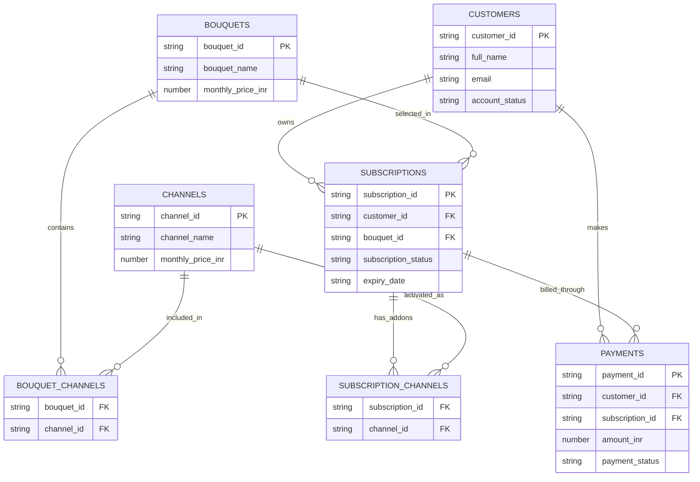

# Sun Direct Customer Support — Database Schema

**Database:** `telecaller` (verified deployed database; the seed loader uses this name)
**Database Engine:** MongoDB Atlas
**Data Format:** CSV imported as MongoDB collections
**Dataset Type:** Synthetic test data
**Pricing:** Illustrative, not verified official Sun Direct pricing

Counts below describe the original fixture. The optional caller seed adds a
synthetic customer; confirmed issues add `support_tickets` records using the DOCX
form fields. Payments and subscriptions remain unchanged.

## 1. Collections Overview

| Collection | Records | Primary Key | Description |
|---|---:|---|---|
| `customers` | 100 | `customer_id` | Customer personal information |
| `channels` | 36 | `channel_id` | Channel catalog and individual prices |
| `bouquets` | 12 | `bouquet_id` | Available subscription packages |
| `bouquet_channels` | 96 | Composite key | Channels included in each bouquet |
| `subscriptions` | 100 | `subscription_id` | Customer subscription records |
| `subscription_channels` | 25 | Composite key | Individually activated channel add-ons |
| `payments` | 397 | `payment_id` | Customer payment transactions |
| `service_requests` | Created empty | `request_id` | Managed-agent complaints, bookings, connection/relocation/cancellation requests |
| `orders` | Created empty | `order_id` | Confirmed synthetic equipment requests, linked to a delivery |
| `deliveries` | Created empty | `delivery_id` | Caller-scoped fulfilment facts linked to an order and its line items |

MongoDB automatically generates an `_id` for each imported document unless one is supplied. The application uses the explicit IDs above as its business identifiers.

The three managed-agent collections were created during the October 29, 2026 setup.
Confirmed calls can add records; the initial empty counts are not live counts.
See [customer service data model](docs/customer-services.md) for their fields,
relationships, transaction behaviour, confirmation flow and permitted spoken data.

## 2. Collection Metadata

### 2.1 customers

**Purpose:** Stores customer identification and profile details.

| Field | Type | Description |
|---|---|---|
| `customer_id` | String | Unique customer identifier |
| `full_name` | String | Customer's name |
| `email` | String | Email address |
| `phone` | String | Contact identifier |
| `city` | String | Customer city |
| `state` | String | Customer state |
| `country` | String | Country |
| `registered_on` | Date string | Registration date |
| `account_status` | String | Active / Suspended |
| `data_type` | String | SYNTHETIC |
| `username` | String optional | Registered username for local synthetic verification |
| `phone_normalized` | String optional | Normalized +91 simulated caller lookup |
| `smartcard_id` | String optional | Stored synthetic smartcard ID, checked locally and excluded from model context |
| `service_address` | String or object optional | Saved house/street address used for service visits and as a delivery fallback |
| `delivery_address`, `home_address`, `address` | String or object optional | Supported saved address aliases; purpose-specific fields take precedence |
| `house_number` | Integer optional | Synthetic fixture house number, three digits |
| `street_address` | Integer optional | Synthetic six-digit street identifier; not a postcode |
| `address_data_type` | String optional | `SYNTHETIC` for explicitly generated fictional fixture addresses |

**Primary Key:** `customer_id`

**Relationships:**
- One customer can have multiple subscription records.
- One customer can have multiple payment records.
- One customer can have multiple service requests, equipment orders and deliveries.
- These application relationships are checked through the bound caller and MongoDB
  transactions; they are not automatic MongoDB foreign-key constraints.

### 2.2 channels

**Purpose:** Stores individual television channels and their pricing.

| Field | Type | Description |
|---|---|---|
| `channel_id` | String | Unique channel identifier |
| `channel_name` | String | Channel name |
| `language` | String | Broadcasting language |
| `genre` | String | Entertainment, Sports, News, etc. |
| `monthly_price_inr` | Number | Illustrative monthly channel price |
| `is_hd` | Boolean | HD availability flag |
| `is_active` | Boolean | Catalog availability |
| `pricing_status` | String | ILLUSTRATIVE_NOT_OFFICIAL |

**Primary Key:** `channel_id`

**HTML catalog import (October 31, 2026):** `pretty.html` supplies 254 unique
channel rows in 19 sections. The merge updates 30 exact name-and-format matches,
adds 224 generated IDs, and retains six existing referenced records: 260 total.
Existing IDs and package/add-on references are preserved. Source channel names,
numbers, HD/SD, price text and image metadata are not rebranded or rewritten.

Imported records add these fields:

| Field | Meaning |
|---|---|
| `channel_number` | Original TD text, stored as a string |
| `hd_sd` | Original `HD` or `SD` text |
| `price` | Original price text, including `Free` or the rupee symbol |
| `price_inr` | Decimal128 parsed amount; `Free` maps to zero |
| `monthly_price_inr`, `billing_period` | Null when the source does not specify a period |
| `language`, `genre` | Exact section label only when it explicitly denotes that feature; otherwise null |
| `source_section`, `source_heading` | Unchanged source labels |
| `source_headers`, `source_values` | Original table headers and TD text values |
| `source_cells` | Each cell's text, inner HTML and attributes, in original column order |
| `source_row_attributes` | Original row attributes |
| `logo_attributes`, `logo_url` | Original image attributes; URL uses `data-original` before placeholder `src` |
| `source_file`, `source_sha256` | Source filename and byte-content hash |
| `data_type` | `IMPORTED_HTML` |
| `pricing_status` | `SOURCE_LISTED_UNVERIFIED` |
| `availability_status` | `SOURCE_LISTED_NOT_VERIFIED`; catalog listing does not verify broadcast availability |

The original fixture's monthly-price description above applies only to fixture
rows. Imported amounts must not be presented as verified official or monthly
prices without separate evidence. Package prices remain synthetic examples.
The `channel_id` field now has a unique index.

**Relationships:**
- A channel may belong to multiple bouquets.
- A channel may be independently activated on multiple subscriptions.

### 2.3 bouquets

**Purpose:** Stores available subscription packages.

| Field | Type | Description |
|---|---|---|
| `bouquet_id` | String | Unique bouquet identifier |
| `bouquet_name` | String | Package name |
| `primary_language` | String | Primary language or Multi |
| `monthly_price_inr` | Number | Illustrative monthly package price |
| `currency` | String | INR |
| `is_active` | Boolean | Package availability |
| `pricing_status` | String | ILLUSTRATIVE_NOT_OFFICIAL |

**Primary Key:** `bouquet_id`

**Relationships:**
- One bouquet can be used by multiple subscriptions.
- One bouquet contains multiple channels through `bouquet_channels`.

### 2.4 bouquet_channels

**Purpose:** Maps channels to bouquets.

| Field | Type | Description |
|---|---|---|
| `bouquet_id` | String | Reference to bouquets |
| `channel_id` | String | Reference to channels |

**Composite Unique Key:** (`bouquet_id`, `channel_id`)

This collection implements a many-to-many relationship.

**Synthetic rebuild, October 31, 2026:** the 12 existing demo bouquets now use
488 links derived from the imported HTML sections. Each link includes
`membership_basis: SYNTHETIC_SECTION_BASED_NOT_OFFICIAL` and `source_sha256`.
Bouquets include `membership_rule`, `membership_basis` and
`channel_catalog_revision`. These contents are generated demo rules, not official
provider package definitions. Prices remain the original illustrative fixtures.
See [membership rules](docs/membership-rebuild.md).

An additional user-requested synthetic **Tech Five Malayalam English Family**
package contains 43 imported channels: Malayalam, English, Kids, Infotainment
and all source-listed Discovery variants. Its price is null with
`pricing_status: UNQUOTED_SYNTHETIC_DEMO`, never a zero-price offer. One 30-day,
nonrenewing demo subscription was assigned without a payment. Following this
seed there are 13 bouquets, 531 package-channel links and 101 subscriptions.

### 2.5 subscriptions

**Purpose:** Stores the customer's current or historical subscription records.

| Field | Type | Description |
|---|---|---|
| `subscription_id` | String | Unique subscription identifier |
| `customer_id` | String | Reference to customers |
| `bouquet_id` | String | Reference to bouquets |
| `start_date` | Date string | Subscription start date |
| `expiry_date` | Date string | Subscription expiry date |
| `subscription_status` | String | Active / Expired |
| `auto_renew` | Boolean | Auto-renewal preference |
| `billing_cycle` | String | Monthly |
| `channel_catalog_revision` | String optional | Imported catalog SHA-256 used by the current synthetic membership rebuild |
| `channel_membership_basis` | String optional | `SYNTHETIC_SECTION_BASED_NOT_OFFICIAL`; does not change dates or status |

**Primary Key:** `subscription_id`

**Foreign References:**
- `customer_id` → `customers.customer_id`
- `bouquet_id` → `bouquets.bouquet_id`

### 2.6 subscription_channels

**Purpose:** Stores individually activated channel add-ons outside the subscribed bouquet.

| Field | Type | Description |
|---|---|---|
| `subscription_id` | String | Reference to subscriptions |
| `channel_id` | String | Reference to channels |
| `activated_on` | Date string | Activation date |
| `status` | String | Active / Expired |

**Composite Unique Key:** (`subscription_id`, `channel_id`)

The rebuild retains all 25 add-ons, remapping two reviewed synthetic aliases to
their imported SD channel IDs. Changed rows include `catalog_migration` with the
previous channel ID/name, replacement name, synthetic basis and source hash.
Activation dates and statuses are unchanged. Channel rows kept only for history
have `catalog_reference_status: LEGACY_NOT_IN_IMPORTED_SOURCE`; reviewed aliases
also have `canonical_channel_id`. All rebuilt package and add-on links reference
the 254 imported source records.

### 2.7 payments

**Purpose:** Stores payment transactions associated with customers and subscriptions.

| Field | Type | Description |
|---|---|---|
| `payment_id` | String | Unique payment identifier |
| `customer_id` | String | Reference to customers |
| `subscription_id` | String | Reference to subscriptions |
| `payment_date` | Date string | Transaction date |
| `amount_inr` | Number | Transaction amount |
| `payment_method` | String | UPI, Card, Net Banking, Wallet |
| `payment_status` | String | Successful / Failed |
| `transaction_reference` | String | Unique transaction reference |
| `currency` | String | INR |

**Primary Key:** `payment_id`

**Foreign References:**
- `customer_id` → `customers.customer_id`
- `subscription_id` → `subscriptions.subscription_id`

## 3. Entity Relationship Diagram



## 4. Relationship Mapping

| Parent Collection | Child Collection | Join Field | Cardinality |
|---|---|---|---|
| customers | subscriptions | customer_id | 1:N |
| customers | payments | customer_id | 1:N |
| bouquets | subscriptions | bouquet_id | 1:N |
| bouquets | bouquet_channels | bouquet_id | 1:N |
| channels | bouquet_channels | channel_id | 1:N |
| subscriptions | subscription_channels | subscription_id | 1:N |
| channels | subscription_channels | channel_id | 1:N |
| subscriptions | payments | subscription_id | 1:N |

MongoDB does not automatically enforce these foreign-key relationships. The application must validate them.

## 5. Example MongoDB Lookup

**Use case:** Retrieve a customer's subscription and bouquet information.

```javascript
db.customers.aggregate([
  {
    $match: {
      customer_id: "CUST00001"
    }
  },
  {
    $lookup: {
      from: "subscriptions",
      localField: "customer_id",
      foreignField: "customer_id",
      as: "subscriptions"
    }
  },
  {
    $unwind: "$subscriptions"
  },
  {
    $lookup: {
      from: "bouquets",
      localField: "subscriptions.bouquet_id",
      foreignField: "bouquet_id",
      as: "bouquet"
    }
  },
  {
    $unwind: "$bouquet"
  },
  {
    $project: {
      _id: 0,
      customer_id: 1,
      full_name: 1,
      subscription_id:
        "$subscriptions.subscription_id",
      subscription_status:
        "$subscriptions.subscription_status",
      expiry_date:
        "$subscriptions.expiry_date",
      bouquet_name: "$bouquet.bouquet_name",
      monthly_price_inr:
        "$bouquet.monthly_price_inr"
    }
  }
])
```

This query returns subscription records, including expired ones. Filter on status and expiry date when retrieving a currently valid subscription.

## 6. MongoDB Indexes

```javascript
db.customers.createIndex(
  { customer_id: 1 },
  { unique: true }
)

db.channels.createIndex(
  { channel_id: 1 },
  { unique: true }
)

db.bouquets.createIndex(
  { bouquet_id: 1 },
  { unique: true }
)

db.subscriptions.createIndex(
  { subscription_id: 1 },
  { unique: true }
)

db.subscriptions.createIndex(
  { customer_id: 1 }
)

db.payments.createIndex(
  { payment_id: 1 },
  { unique: true }
)

db.payments.createIndex(
  { transaction_reference: 1 },
  { unique: true }
)

db.payments.createIndex(
  { customer_id: 1, payment_date: -1 }
)

db.payments.createIndex(
  { subscription_id: 1 }
)

db.bouquet_channels.createIndex(
  { bouquet_id: 1, channel_id: 1 },
  { unique: true }
)

db.bouquet_channels.createIndex(
  { channel_id: 1 }
)

db.subscription_channels.createIndex(
  { subscription_id: 1, channel_id: 1 },
  { unique: true }
)

db.subscription_channels.createIndex(
  { channel_id: 1 }
)
```

## 7. Data Integrity Tests

The following tests should pass after importing the seven CSV files:

- All primary business IDs are unique.
- Every subscription references an existing customer.
- Every subscription references an existing bouquet.
- Every payment references an existing customer and subscription.
- Every payment's customer ID matches the customer ID of its referenced subscription.
- Every bouquet-channel mapping references an existing bouquet and channel.
- Every subscription-channel mapping references an existing subscription and channel.
- No duplicate composite mapping keys exist.
- Payment amounts and package prices are non-negative.
- Subscription expiry dates are later than their start dates.
- Date fields can be parsed consistently.
- Boolean fields are correctly converted during CSV import.

## 8. Agent Tool-to-Collection Mapping

| Agent Tool | Collections Accessed |
|---|---|
| `get_customer_profile` | customers |
| `get_active_plan` | subscriptions, bouquets |
| `get_active_channels` | subscriptions, bouquet_channels, subscription_channels, channels |
| `get_payment_history` | payments |
| `check_payment_status` | payments |
| `get_previous_recharge` | customers, payments, subscriptions, bouquets, bouquet_channels, channels |
| `confirm_recharge_choice` | customers, bouquets; session-only choice confirmation, no database writes |
| `list_bouquets` | bouquets |
| `compare_plans` | bouquets, bouquet_channels, channels |
| `recommend_plan` | bouquets, bouquet_channels, channels |
| `search_knowledge` | FAISS, not MongoDB |

All customer-specific tools must be scoped to the authenticated customer identity.

## 9. Test Scenarios

**Scenario A — Customer Profile**

Input: `CUST00001`

Expected: Retrieve the customer profile and account status.

**Scenario B — Active Package**

Input: `CUST00001`

Expected: Resolve the customer's subscription and associated bouquet, then verify current validity.

**Scenario C — Activated Channels**

Input: `CUST00004`

Expected: Combine channels included in the customer's bouquet with any active add-on channels, removing duplicates.

**Scenario D — Payment History**

Input: `CUST00001`

Expected: Retrieve payment records ordered by payment date, newest first.

**Scenario E — Package Comparison**

Input: `BQ001` and `BQ002`

Expected: Compare bouquet prices, channel counts, shared channels and exclusive channels.

**Scenario F — Invalid Customer**

Input: `CUST99999`

Expected: Return a structured `CUSTOMER_NOT_FOUND` result rather than inventing customer details.

## 10. Implementation Notes

1. Store customer identifiers and other business IDs as strings.
2. Convert ISO date strings to BSON Date values where appropriate.
3. Convert numeric prices and payment amounts to appropriate numeric types, preferably Decimal128 for monetary values.
4. Convert CSV boolean values into actual MongoDB booleans.
5. Do not expose customer records until the session has been authenticated.
6. Treat FAISS as the training-manual knowledge store and MongoDB as the structured customer-data source.
7. Never treat illustrative package prices as verified live Sun Direct tariffs.
8. Avoid making subscription or payment modifications without verified authorization and explicit confirmation.

---

**Document Status:** Development and integration testing schema
**Version:** 1.0
**Target Application:** Gemini + LangGraph + MongoDB + FAISS + Deepgram Telecom Support Agent
